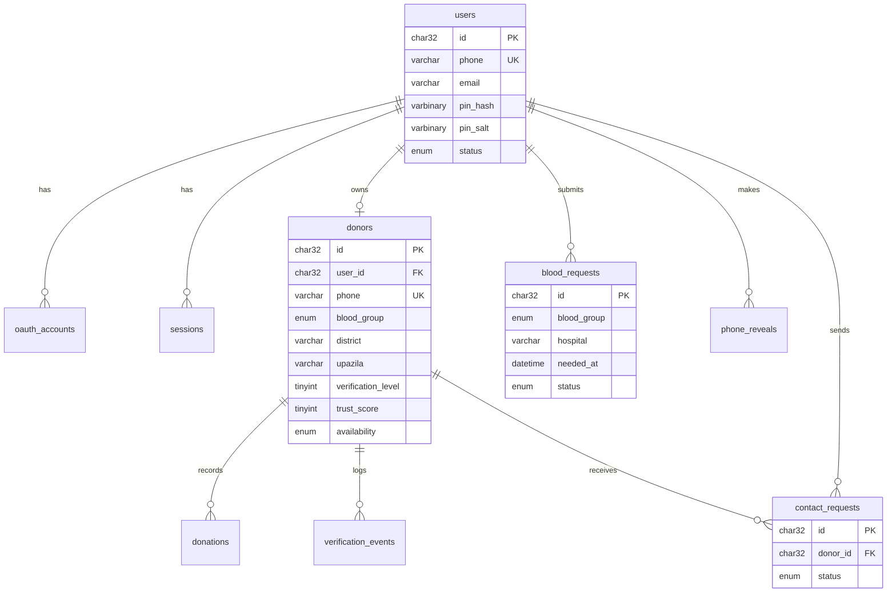

# Renewal Blood Network — ARCHITECTURE

> রিনিউয়েল ব্লাড নেটওয়ার্ক: বাংলাদেশের সব জেলা ও উপজেলাজুড়ে একটি রিয়েল-টাইম, স্বেচ্ছাসেবী রক্তদাতা নেটওয়ার্ক।
> রক্তদাতা নিবন্ধন, দাতা খোঁজা, জরুরি রক্তের অনুরোধ, এবং অ্যাডমিন যাচাই — একই সার্ভার থেকে।

| | |
|---|---|
| Backend | Python 3.11+, FastAPI, Uvicorn |
| Database | MySQL 8.0+ (MariaDB 10.6+ সামঞ্জস্যপূর্ণ), InnoDB, `utf8mb4` |
| Frontend | দুটি single-file SPA (`index.html`, `admin.html`), CSS/JS inline |
| Real-time | WebSocket `/ws/realtime` |
| Bot protection | Cloudflare Turnstile |
| Login | ফোন + ৪ অঙ্কের PIN, Google OAuth 2.0 |
| সেশন | `HttpOnly` কুকি + CSRF টোকেন (`X-CSRF-Token`) |
| SMS OTP | আপাতত বন্ধ — ফোন নম্বর অযাচাইকৃত (§২ D11) |
| ভাষা | বাংলা + ইংরেজি (UI দ্বিভাষিক) |

---

## ১. লক্ষ্য ও সীমানা

**লক্ষ্য**
- রক্তের প্রয়োজনে দ্রুত দাতা খুঁজে পাওয়া (রক্তের গ্রুপ, জেলা, উপজেলা, এলাকা, availability)।
- জরুরি রক্তের অনুরোধ জমা দেওয়া ও অ্যাডমিন দ্বারা যাচাই।
- দাতার বিশ্বাসযোগ্যতা (Trust Score) ও লিডারবোর্ড।
- সব ক্লায়েন্টে লাইভ আপডেট।

**সীমানার বাইরে (Non-goals)**
- পেমেন্ট, রক্ত ব্যাংক ইনভেন্টরি, চ্যাট/মেসেজিং, মোবাইল নেটিভ অ্যাপ।
- SMS OTP — **আপাতত বন্ধ**; ভবিষ্যতে যোগ করা যাবে (§১৬)। ফলে ফোন নম্বর অযাচাইকৃত, আর সেই কারণে নম্বর প্রকাশে কড়া সীমা আছে (§৮.৩)।

---

## ২. মূল নকশা সিদ্ধান্ত

| # | সিদ্ধান্ত | কারণ |
|---|---|---|
| D1 | **একটাই FastAPI প্রসেস/অ্যাপ**, `admin.py` একটি `APIRouter(prefix="/admin")` | আলাদা পোর্ট ও কোড ডুপ্লিকেশন বাদ; এক deploy, এক config |
| D2 | **HTML `templates/`-এ, স্ট্যাটিক অ্যাসেট `static/`-এ** | কাঠামো পরিষ্কার; `Jinja2Templates` দিয়ে প্রতি রিকোয়েস্টে CSP nonce বসানো যায় |
| D3 | **CSS/JS inline, আলাদা ফাইল নেই** | প্রতিটি পেজ একটি ফাইল; strict CSP-তে nonce দিয়ে নিরাপদ inline |
| D4 | **Async MySQL (SQLAlchemy Core + `asyncmy`)**, ORM নয়, raw parameterized SQL/Core | ছোট স্কিমা, পূর্ণ নিয়ন্ত্রণ, SQL injection নেই |
| D5 | **Real-time = `change_log` টেবিল + প্রতি worker-এ poll** | Redis ছাড়াই multi-worker সঠিক |
| D6 | **Rate limit ৩ স্তরে** (Edge → App → Account lockout) | ৪ অঙ্কের PIN-এর জন্য IP-ভিত্তিক সীমা যথেষ্ট নয় |
| D7 | **Turnstile fail-closed** | যাচাই সার্ভিস ডাউন হলে সংবেদনশীল action বন্ধ |
| D8 | **গেস্ট কোনো ফোন নম্বর দেখে না; লগইন করা ব্যবহারকারী `reveal` দিয়ে দেখে — কোটা ও লগসহ** | জরুরি সময়ে দ্রুত যোগাযোগ, অথচ স্ক্র্যাপিং প্রতিরোধ |
| D9 | **সেশন = `HttpOnly` কুকি + CSRF টোকেন**; `localStorage`-এ কিছু নয় | XSS হলেও সেশন টোকেন চুরি যায় না |
| D10 | **Rate limit হাইব্রিড:** সংবেদনশীল বাকেট shared store-এ, বেশি ট্রাফিকের বাকেট লোকাল | multi-worker-এ সঠিকতা ও কম খরচ |
| D11 | **SMS OTP বন্ধ** | খরচ ও জটিলতা এড়াতে; ক্ষতিপূরণ: reveal কোটা + অ্যাডমিন যাচাই |

---

## ৩. হাই-লেভেল আর্কিটেকচার

```
 Browser (index.html)          Browser (admin.html)
        │  HTTPS / WSS + কুকি         │  HTTPS / WSS + অ্যাডমিন কুকি
        ▼                             ▼
 ┌──────────────────────────────────────────────┐
 │ Cloudflare / Nginx   ── Rate limit L1, TLS   │
 └──────────────────────────┬───────────────────┘
                            ▼
 ┌─────────────────── FastAPI (uvicorn) ───────────────────┐
 │  middleware: real-IP → request-id → security headers    │
 │              (CSP nonce) → global rate limit            │
 │                                                         │
 │  app.py       GET /, /static/*, /api/*                  │
 │  admin.py     GET /admin, /admin/api/*                  │
 │  realtime.py  WS /ws/realtime  (hub + change_log poller)│
 │                                                         │
 │  security.py  PIN hash, tokens, Turnstile, Google       │
 │  ratelimit.py limiter + lockout                         │
 │  db.py        async pool, helpers, bump_version()       │
 └───────────────┬───────────────────────┬─────────────────┘
                 ▼                       ▼
            MySQL (InnoDB)      Cloudflare Turnstile · Google
```

---

## ৪. প্রজেক্ট কাঠামো

```
renewal-blood-network/
├── app.py              # FastAPI entry: lifespan, middleware, পাবলিক API, পেজ রুট
├── admin.py            # APIRouter(prefix="/admin"): admin পেজ + admin API
├── realtime.py         # WebSocket hub, change_log poller, broadcast
├── db.py               # engine/pool, query helper, bump_version(), row mapper
├── security.py         # scrypt PIN, token, Turnstile, Google, auth dependencies (current_admin, superadmin_*)
├── passwords.py        # অ্যাডমিন পাসওয়ার্ড scrypt হ্যাশ, ইউজারনেম নিয়ম (কোনো অভ্যন্তরীণ import নেই)
├── ratelimit.py        # limiter backends, lockout, dependency factory
├── schemas.py          # Pydantic মডেল (request/response, validators)
├── trust.py            # calc_trust_score(), badge নিয়ম
├── config.py           # pydantic-settings, .env লোড
├── schema.sql          # সম্পূর্ণ DB স্কিমা (§১২)
├── requirements.txt
├── .env.example
├── ARCHITECTURE.md
│
├── templates/
│   ├── index.html      # পাবলিক SPA (inline CSS + JS, nonce সহ)
│   └── admin.html      # অ্যাডমিন SPA (inline CSS + JS, nonce সহ)
│
├── static/
│   ├── img/            # header.svg, footer.svg, favicon.svg, logo
│   ├── vendor/         # (ঐচ্ছিক, প্রস্তাবিত) leaflet/, fontawesome/ — CDN নির্ভরতা কমাতে
│   └── data/
│       └── bd-geo.json # জেলা → উপজেলা তালিকা (শুধু ডেটা, কোড নয়)
│
└── deploy/
    ├── nginx.conf      # rate limit, WS proxy, security header (§১১)
    └── renewal.service # systemd unit
```

### মডিউলের দায়িত্ব

| ফাইল | দায়িত্ব | নিষেধ |
|---|---|---|
| `app.py` | অ্যাপ তৈরি, middleware, পাবলিক রুট, `admin.router` mount | বিজনেস লজিক বেশি রাখা নয় |
| `admin.py` | admin লগইন, moderation রুট, audit লগ লেখা | পাবলিক রুটের কোড কপি নয় |
| `realtime.py` | সংযোগ হাব, subscription scope, poller | DB-তে mutation নয় |
| `db.py` | সব SQL এখানে বা এখান থেকে কল; transaction helper | HTTP জানে না |
| `security.py` | ক্রিপ্টো, কুকি/CSRF, বাইরের যাচাই, `current_user`/`current_admin`/`csrf_protect` dependency | রুট লজিক নয় |
| `ratelimit.py` | সীমা প্রয়োগ, lockout | — |
| `schemas.py` | ইনপুট যাচাই (ফোন, গ্রুপ, PIN, জেলা) | — |

---

## ৫. রিকোয়েস্ট লাইফসাইকেল

Middleware ও dependency-র ক্রম (উপর থেকে নিচে):

1. **Real-IP resolve** — `CF-Connecting-IP`/`X-Forwarded-For` শুধু তখনই বিশ্বাসযোগ্য যখন সরাসরি peer `TRUSTED_PROXIES`-এর মধ্যে।
2. **Request-ID + structured log**।
3. **Security headers** — CSP (nonce), `X-Content-Type-Options`, `Referrer-Policy`, `Permissions-Policy`, HSTS।
4. **Global rate limit** — প্রতি IP-তে মোটা সীমা (§১০)।
5. **Origin/Referer যাচাই** — `POST/PUT/PATCH/DELETE`-এ `Origin` (না থাকলে `Referer`) `ALLOWED_ORIGINS`-এর সাথে না মিললে `403 csrf_failed`।
6. **Route-level dependency** — endpoint-ভিত্তিক সীমা → Turnstile যাচাই → auth (কুকি থেকে `current_user` / `current_admin`) → **CSRF টোকেন যাচাই** (সেশন-সহ mutation-এ)।
7. **Pydantic validation** → handler → **transaction** (mutation হলে `bump_version()` একই transaction-এ)।
8. **Commit-এর পর** স্থানীয় broadcast।

ত্রুটির ফরম্যাট (সব API):

```json
{ "error": { "code": "rate_limited", "message": "অনুগ্রহ করে কিছুক্ষণ পরে চেষ্টা করুন", "retry_after": 30 } }
```

`code` উদাহরণ: `validation_error`, `unauthorized`, `forbidden`, `not_found`, `conflict` (ফোন আগে থেকেই আছে), `turnstile_failed`, `csrf_failed` (403), `phone_hidden` (403, দাতা শুধু অ্যাডমিন-মাধ্যমে), `quota_exceeded` (429, reveal কোটা শেষ), `locked_out`, `rate_limited`। রেট-লিমিটে HTTP `429` + `Retry-After` হেডার।

---

## ৬. ফ্রন্টএন্ড

### পেজ পরিবেশন
- `GET /` → `templates/index.html`, `GET /admin` → `templates/admin.html` (`Jinja2Templates`, প্রতি রিকোয়েস্টে নতুন `nonce`)।
- প্রতিটি `<style>` ও `<script>` ট্যাগে `nonce="{{ nonce }}"`। CSP-তে `'unsafe-inline'` লাগে না।
- `/static/*` শুধু ছবি, ভেন্ডর লাইব্রেরি, GeoJSON/JSON ডেটা। `Cache-Control: public, max-age=86400` (ভেন্ডর ফাইলে ফাইলনামে ভার্সন)।
- **কনফিগ:** ক্লায়েন্ট শুরুতে `GET /api/config` থেকে Turnstile site key ও Google client ID/flag নেয় (কোনো secret এম্বেড নয়)।

### `index.html` (পাবলিক SPA)
হ্যাশ-ভিত্তিক রাউটিং (`#home`, `#find-donor`, …)।

| View | কাজ | ব্যবহৃত API |
|---|---|---|
| Home (Landing) | Hero, রক্তের গ্রুপ Overview | `GET /api/stats` |
| দাতা খুঁজুন | গ্রুপ/জেলা/উপজেলা/এলাকা/availability ফিল্টার; কার্ডে "নম্বর দেখুন" বাটন (গেস্টের জন্য "লগইন করে দেখুন") | `GET /api/donors/search`, `POST /api/donors/{id}/reveal` |
| নিবন্ধন | ৩ ধাপ: অ্যাকাউন্ট (ফোন, PIN, Turnstile) → ব্যক্তিগত তথ্য → দান-সংক্রান্ত তথ্য | `GET /api/auth/check-phone`, `POST /api/auth/signup`, `POST /api/donors` |
| জরুরি রক্ত | অনুরোধ ফরম + Turnstile; verified অনুরোধের তালিকা | `POST /api/requests`, `GET /api/requests`, `POST /api/requests/{id}/reveal` |
| ড্যাশবোর্ড | নিজের প্রোফাইল, availability, ইতিহাস। ৩ অবস্থা: লগইন নেই / নিবন্ধন অসম্পূর্ণ / পূর্ণ | `GET /api/auth/me`, `GET/PUT /api/donors/{id}`, `GET /api/donors/{id}/reveal-stats` |
| ম্যাপ | Leaflet-এ দাতা ও জেলাভিত্তিক কভারেজ | `GET /api/map` |
| লিডারবোর্ড | Trust Score অনুযায়ী র‍্যাংকিং | `GET /api/leaderboard` |
| মডাল | `auth-modal` (লগইন/Google), `contact-modal` (দাতা শুধু অ্যাডমিনের মাধ্যমে যোগাযোগ চাইলে, বা কোটা শেষ হলে) | `POST /api/auth/login`, `POST /api/contacts` |

### `admin.html` (অ্যাডমিন SPA)
1. **লগইন গেট** — পাসওয়ার্ড + Turnstile।
2. **মূল লেআউট** — Sidebar + উপরে Stats Grid।
3. **ট্যাব:** যাচাই বাকি · জরুরি অনুরোধ · যোগাযোগ অনুরোধ · রক্তের গ্রুপ · সব দাতা · ট্রেন্ড (চার্ট)।

### ফ্রন্টএন্ড নিয়ম
- সার্ভার থেকে আসা সব টেক্সট `textContent` দিয়ে বসানো; `innerHTML`-এ ইউজার ডেটা নয়।
- **কোনো টোকেন `localStorage`/`sessionStorage`-এ নয়।** সেশন `HttpOnly` কুকিতে, JS তা পড়তে পারে না। CSRF টোকেন শুধু JS ভ্যারিয়েবলে (মেমরিতে); পেজ রিলোডে `GET /api/auth/me` (অ্যাডমিনে `GET /admin/api/me`) থেকে আবার নেওয়া হয়।
- সব `fetch` একটি wrapper দিয়ে: `credentials: 'same-origin'`; `POST/PUT/PATCH/DELETE`-এ `X-CSRF-Token` হেডার; `403 csrf_failed` পেলে একবার টোকেন রিফ্রেশ করে পুনরায় চেষ্টা; `401` পেলে লগইন মডাল।
- WebSocket-এ বার্তা পেলে শুধু প্রাসঙ্গিক অংশ আবার fetch; সংযোগ ছিঁড়লে exponential backoff-এ পুনঃসংযোগ।
- বাইরের CDN (Turnstile, Google Sign-In, মানচিত্রের টাইল) CSP allow-list-এ। Leaflet ও Font Awesome `static/vendor/`-এ রাখা প্রস্তাবিত।

---

## ৭. API রেফারেন্স

**Auth কলাম:** `—` পাবলিক (গেস্ট) · `U` ইউজার সেশন কুকি · `A` অ্যাডমিন সেশন কুকি · **T** = Turnstile বাধ্যতামূলক।
`U`/`A` রুটের সব mutation-এ `X-CSRF-Token` বাধ্যতামূলক (§৮.২)। সীমাগুলো §১০-এ বিস্তারিত।

### পাবলিক (`app.py`)

| Method | Path | Auth | T | বিবরণ |
|---|---|:-:|:-:|---|
| GET | `/` | — | | `index.html` |
| GET | `/api/health` | — | | সার্ভিস স্ট্যাটাস |
| GET | `/api/config` | — | | Turnstile site key, Google flag |
| GET | `/api/stats` | — | | মোট দাতা, available, verified অনুরোধ, গ্রুপভিত্তিক গণনা (ক্যাশড) |
| POST | `/api/auth/signup` | — | T | ফোন + PIN দিয়ে ইউজার তৈরি; `Set-Cookie` সেশন; বডিতে `csrfToken` |
| POST | `/api/auth/login` | — | T | ফোন + PIN; `Set-Cookie` সেশন; বডিতে `csrfToken` |
| POST | `/api/auth/google` | — | | Google ID token যাচাই; ইউজার তৈরি/লিংক; `Set-Cookie`; `csrfToken` |
| GET | `/api/auth/me` | U | | বর্তমান ইউজার + donor প্রোফাইল (থাকলে) + নতুন `csrfToken` |
| GET | `/api/auth/check-phone` | — | | ফোন আগে নিবন্ধিত কি না (`{exists: bool}`) |
| POST | `/api/auth/logout` | U | | সেশন বাতিল ও কুকি মোছা |
| GET | `/api/donors/search` | — | | ফিল্টার: `bloodGroup, district, upazila, area, availability, limit, offset`; **ফোন নম্বর নেই** (শুধু `phoneVisible` পতাকা); Trust Score অনুযায়ী সাজানো |
| POST | `/api/donors` | U | T | নিজের donor প্রোফাইল তৈরি (ইউজার প্রতি ১টি; `phoneVisibility` সহ) |
| GET | `/api/donors/{id}` | — | | পাবলিক প্রোফাইল (ফোন ছাড়া) |
| PUT | `/api/donors/{id}` | U (নিজের) | | প্রোফাইল, availability ও `phoneVisibility` হালনাগাদ |
| GET | `/api/requests` | — | | শুধু `verified` অনুরোধ, `contact` ছাড়া |
| POST | `/api/requests` | — | T | জরুরি অনুরোধ জমা (`pending` হয়) |
| POST | `/api/requests/{id}/report` | — | T | অনুরোধ রিপোর্ট (প্রতি reporter-এ ১ বার) |
| POST | `/api/donors/{id}/report` | — | T | দাতা রিপোর্ট |
| POST | `/api/donors/{id}/reveal` | U | T | দাতার পূর্ণ নম্বর (কোটা + লগ; §৮.৩) |
| POST | `/api/requests/{id}/reveal` | U | T | অনুরোধের attendant নম্বর (একই কোটা) |
| GET | `/api/donors/{id}/reveal-stats` | U (নিজের) | | কতজন নম্বর দেখেছে (শুধু সংখ্যা) |
| POST | `/api/contacts` | — | T | দাতার সাথে যোগাযোগের অনুরোধ |
| GET | `/api/leaderboard` | — | | শীর্ষ দাতা (ক্যাশড) |
| GET | `/api/map` | — | | ম্যাপের জন্য সংক্ষিপ্ত দাতা/জেলা ডেটা (নির্ভুল ঠিকানা নয়) |
| WS | `/ws/realtime` | কুকি (ঐচ্ছিক) | | §৯; হ্যান্ডশেকে `Origin` যাচাই |

### অ্যাডমিন (`admin.py`)

| Method | Path | Auth | T | বিবরণ |
|---|---|:-:|:-:|---|
| GET | `/admin` | — | | `admin.html` |
| POST | `/admin/api/login` | — | T | `username` + `password` → `Set-Cookie` অ্যাডমিন সেশন + `csrfToken`, `username`, `role`, `mustChangePassword` |
| POST | `/admin/api/logout` | A* | | সেশন বাতিল ও কুকি মোছা |
| GET | `/admin/api/me` | A* | | সেশন বৈধ কি না + `csrfToken`, `username`, `role`, `mustChangePassword` |
| POST | `/admin/api/change-password` | A* | | `currentPassword` + `newPassword` (≥১০ অক্ষর); অন্য সব সেশন বাতিল |
| GET | `/admin/api/admins` | SA | | অ্যাডমিনদের তালিকা |
| POST | `/admin/api/admins` | SA | | নতুন অ্যাডমিন (`username`); পাসওয়ার্ড = `.env`-এর `ADMIN_TEMP_PASSWORD`, প্রথম লগইনে বদলাতে হয় |
| DELETE | `/admin/api/admins/{id}` | SA | | অ্যাডমিন ডিলিট (সেশন সাথে সাথে বাতিল); সুপার অ্যাডমিনকে নয় |
| GET | `/admin/api/stats` | A | | Stats Grid ও ট্রেন্ড ডেটা |
| GET | `/admin/api/donors` | A | | পূর্ণ (unmasked) তালিকা; ফিল্টার: `suspicious`, `district`, `q` (নাম/ফোন), `donor_id` (সঠিক আইডি); পেজিনেশন |
| PUT | `/admin/api/donors/{id}` | A | | `verification_level`, `suspicious`, `can_donate`, নোট |
| GET | `/admin/api/requests` | A | | সব স্ট্যাটাস |
| PUT | `/admin/api/requests/{id}` | A | | `verified` / `rejected` / `fulfilled` + নোট |
| GET | `/admin/api/contacts` | A | | যোগাযোগ অনুরোধ; প্রতিটিতে দাতার নাম/ফোন/জেলা/উপজেলাও থাকে (`donor_name`, `donor_phone`, `donor_district`, `donor_upazila`) |
| PUT | `/admin/api/contacts/{id}` | A | | স্ট্যাটাস হালনাগাদ |
| GET | `/admin/api/reports` | A | | রিপোর্টের তালিকা |
| GET | `/admin/api/audit` | A | | অ্যাডমিন কার্যকলাপ লগ |
| GET | `/admin/api/users` | A | | ব্যবহারকারী তালিকা (`flagged` ফিল্টার সহ) |
| PUT | `/admin/api/users/{id}` | A | | `active`/`blocked`, `flagged` সাফ করা |
| GET | `/admin/api/reveals` | A | | কে কার নম্বর দেখেছে (ফিল্টার: user, target, সময়) |

প্রতিটি admin mutation `audit_log`-এ লেখা হয় (actor = অ্যাডমিনের ইউজারনেম)।

`A*` = বৈধ সেশন (প্রথম-লগইনের পাসওয়ার্ড বদল বাকি থাকলেও চলে); `A` = বৈধ সেশন **এবং** পাসওয়ার্ড বদলানো; `SA` = শুধু `role = superadmin`। সব অ্যাডমিনের অন্য পারমিশন একই।

### ভ্যালিডেশন নিয়ম (`schemas.py`)

| ফিল্ড | নিয়ম |
|---|---|
| `phone` | বাংলাদেশি মোবাইল `^01[3-9]\d{8}$` (`+880`/`880` উপসর্গ বাদ দিয়ে স্বাভাবিকীকরণ) |
| `pin` | ঠিক ৪টি অঙ্ক |
| `blood_group` | `A+ A- B+ B- AB+ AB- O+ O-` |
| `district`/`upazila` | `static/data/bd-geo.json`-এর তালিকার সাথে মিল |
| `units` | ১–১০ |
| `age` | ১৮–৬০ (দাতা) |
| টেক্সট ফিল্ড | দৈর্ঘ্যসীমা, নিয়ন্ত্রণ-ক্যারেক্টার বাদ |
| `needed_at` | ভবিষ্যৎ, সর্বোচ্চ ৭ দিনের মধ্যে |
| `phoneVisibility` | `members` (ডিফল্ট) \| `admin_only` |

### ফোন নম্বরের দৃশ্যমানতা

| দর্শক | যা দেখে |
|---|---|
| গেস্ট | কোনো নম্বর নয়; "লগইন করে দেখুন" |
| লগইন করা ইউজার | তালিকায় নম্বর নয়; `reveal` করলে পূর্ণ নম্বর (§৮.৩) |
| অ্যাডমিন | সব পূর্ণ নম্বর |

---

## ৮. অথেন্টিকেশন ও সেশন

### ইউজার (ফোন + PIN)
- **হ্যাশ:** `hashlib.scrypt` (`n=2^14, r=8, p=1`), প্রতি ইউজারে ১৬ বাইট salt, তার সাথে সার্ভার-সাইড **pepper** (`PIN_PEPPER`, HMAC-SHA256)। তুলনা `hmac.compare_digest` দিয়ে।
- **কেন pepper:** ৪ অঙ্কের PIN-এর মাত্র ১০,০০০ সম্ভাবনা; DB ফাঁস হলে salt-সহ হ্যাশও সেকেন্ডে ভাঙা যায়। Pepper `.env`-এ থাকলে শুধু DB ফাঁসে PIN নিরাপদ থাকে।
- **সীমাবদ্ধতা (স্পষ্টভাবে):** ৪ অঙ্কের PIN স্বভাবতই দুর্বল। প্রশমন: ফোন-ভিত্তিক lockout, Turnstile, pepper, রেট লিমিট। SMS OTP আপাতত বন্ধ, তাই নিবন্ধনে ফোন নম্বরের মালিকানা যাচাই হয় না। দীর্ঘমেয়াদে OTP প্রস্তাবিত (§১৬)।
- **সেশন:** `secrets.token_urlsafe(32)` কুকিতে যায় (§৮.১); DB-তে শুধু `SHA-256(token)`। মেয়াদ ৩০ দিন, স্থির (নবায়ন নয়)। প্রতিটি লগইনে নতুন টোকেন (session fixation প্রতিরোধ)। লগআউটে সারি মুছে কুকি বাতিল।

### Google OAuth 2.0
1. ক্লায়েন্ট Google Sign-In থেকে ID token পায়।
2. `POST /api/auth/google` → সার্ভার `google.oauth2.id_token.verify_oauth2_token(token, Request(), GOOGLE_CLIENT_ID)` চালায় (blocking কল, threadpool-এ)।
3. `(provider, provider_user_id)` মিললে লগইন; ইমেইল মিললে লিংক; নইলে নতুন `users` সারি। `email_verified = true` না হলে প্রত্যাখ্যান।
4. Google ইউজারের ফোন না থাকলে নিবন্ধন ধাপে ফোন সংগ্রহ।

### Turnstile
- ক্লায়েন্ট টোকেন পাঠায়; সার্ভার `POST https://challenges.cloudflare.com/turnstile/v0/siteverify` (`secret`, `response`, `remoteip`) — `httpx.AsyncClient`, টাইমআউট ৫ সেকেন্ড।
- **Fail-closed:** নেটওয়ার্ক ত্রুটি/টাইমআউট হলে অনুরোধ প্রত্যাখ্যান (`turnstile_failed`)।
- প্রয়োগের স্থান: signup, login, donor তৈরি, জরুরি অনুরোধ, যোগাযোগ অনুরোধ, রিপোর্ট, admin login।
- `TURNSTILE_ENABLED=false` শুধু ডেভেলপমেন্টে।

### অ্যাডমিন
- **মাল্টি-অ্যাডমিন:** `admins` টেবিল (`username` ইউনিক, scrypt `password_hash`, `role` = `superadmin`|`admin`, `must_change_password`)। `admin_sessions.admin_id` FK `ON DELETE CASCADE` — অ্যাডমিন ডিলিট হলে সব সেশন তখনই মুছে যায় (WebSocket ≤৬০ সেকেন্ডে কাটে)।
- **সুপার অ্যাডমিন সিড:** `admins` খালি থাকলে স্টার্টআপে (`ensure_schema`, GET_LOCK-এর ভেতরে) `SUPERADMIN_USERNAME` নামে তৈরি; প্রাথমিক পাসওয়ার্ড `.env`-এর `ADMIN_TEMP_PASSWORD` (হ্যাশ হয়ে DB-তে যায়), `must_change_password = TRUE`। এরপর `.env`-এর মান বদলালে বিদ্যমান পাসওয়ার্ড বদলায় না।
- **অস্থায়ী পাসওয়ার্ড:** সুপার অ্যাডমিন নতুন অ্যাডমিন বানালে তার পাসওয়ার্ডও `ADMIN_TEMP_PASSWORD`; প্রথম লগইনের পর বদলানো ছাড়া `current_admin` সব রুটে `403 password_change_required` দেয় (শুধু `/me`, `/logout`, `/change-password` চলে)। `ADMIN_TEMP_PASSWORD`-ই নতুন পাসওয়ার্ড হিসেবে দেওয়া যায় না।
- **সুপার অ্যাডমিন পাসওয়ার্ড ভুললে:** সার্ভারে `python -m security reset-superadmin` — `ADMIN_TEMP_PASSWORD`-এ ফিরিয়ে সব সেশন বাতিল করে।
- **লকআউট:** আগের IP/গ্লোবাল সীমার সাথে প্রতি-ইউজারনেমে ৫ বার ভুলে ১৫ মিনিট লক।
- পুরনো (একক-অ্যাডমিন) ডাটাবেস স্টার্টআপে নিজে থেকেই মাইগ্রেট হয় (`db._migrate`)।
- `ADMIN_PASSWORD_HASH` এখন ঐচ্ছিক/পুরনো: `ADMIN_TEMP_PASSWORD` না থাকলে শুধু সিডে ব্যবহার হয়।
- সফল লগইনে `admin_sessions`-এ টোকেন (মেয়াদ ৮ ঘণ্টা, hash সংরক্ষিত) এবং অ্যাডমিন সেশন কুকি সেট হয় (`SameSite=Strict`)।
- ঐচ্ছিক: `ADMIN_IP_ALLOWLIST` দিয়ে `/admin/*` সীমিত করা।
- সব `/admin/api/*` রুটে `Depends(current_admin)`; mutation-এ অতিরিক্ত `Depends(csrf_protect)`।

---

### ৮.১ সেশন কুকি

| | ইউজার | অ্যাডমিন |
|---|---|---|
| নাম (production) | `__Host-sid` | `__Host-asid` |
| নাম (dev, `http`) | `sid` | `asid` |
| মান | র‍্যান্ডম টোকেন (২৫৬ বিট) | একই |
| `HttpOnly` | হ্যাঁ | হ্যাঁ |
| `Secure` | হ্যাঁ (prod) | হ্যাঁ (prod) |
| `SameSite` | `Lax` | `Strict` |
| `Path` / `Domain` | `/` / নেই | `/` / নেই |
| `Max-Age` | ২৫৯২০০০ (৩০ দিন) | ২৮৮০০ (৮ ঘণ্টা) |

- `__Host-` উপসর্গ ব্রাউজারকে বাধ্য করে: `Secure`, `Path=/`, কোনো `Domain` নয় — সাবডোমেইন থেকে কুকি ওভাররাইট করা যায় না।
- ইউজার কুকিতে `Lax`: বাইরের লিংক থেকে সাইটে এলে লগইন বজায় থাকে; সব mutation POST/PUT/DELETE বলে `Lax` সেগুলো ক্রস-সাইটে পাঠায় না। অ্যাডমিনে `Strict`।
- ইউজার ও অ্যাডমিন কুকি আলাদা নামে, তাই একই ব্রাউজারে দুটিই থাকতে পারে, একে অপরকে প্রভাবিত করে না।
- `COOKIE_SECURE=false` (শুধু ডেভ, `http://localhost`) হলে `__Host-` উপসর্গ ও `Secure` বাদ যায়।
- লগআউটে `Set-Cookie: <নাম>=; Max-Age=0; Path=/`।

### ৮.২ CSRF সুরক্ষা

কুকি ব্রাউজার নিজে পাঠায়, তাই কুকি-ভিত্তিক সেশনে CSRF প্রতিরোধ বাধ্যতামূলক। তিন স্তর:

1. **`SameSite`** — প্রথম বাধা (§৮.১)।
2. **Origin/Referer যাচাই** — প্রতিটি `POST/PUT/PATCH/DELETE`-এ `Origin` হেডার `ALLOWED_ORIGINS`-এর একটির সমান হতে হবে (`Origin` না থাকলে `Referer`-এর origin); নইলে `403 csrf_failed`। দুটোই অনুপস্থিত থাকলে কুকি-অথেন্টিকেটেড রিকোয়েস্ট প্রত্যাখ্যান।
3. **CSRF টোকেন (stateless synchronizer)**
   - `csrf = base64url(HMAC_SHA256(CSRF_SECRET, session_token_hash))` — আলাদা কলাম বা সারি লাগে না।
   - লগইন/সাইনআপ/`me` রেসপন্স বডিতে `csrfToken` আসে; ক্লায়েন্ট তা মেমরিতে রাখে।
   - প্রতিটি mutation-এ `X-CSRF-Token` হেডার; সার্ভার পুনর্গণনা করে `hmac.compare_digest` দিয়ে মেলায়।
   - সেশন বদলালে টোকেনও বদলায়; টোকেন কুকিতে বা URL-এ কখনো নয়।

**গেস্ট (সেশনহীন) POST** — যেমন লগইন, সাইনআপ, জরুরি অনুরোধ — এখানে CSRF টোকেন নেই, কারণ সেশন নেই। সুরক্ষা: Origin যাচাই + Turnstile টোকেন (একবারের ব্যবহারযোগ্য)। এতে "login CSRF" (আক্রমণকারী ভিক্টিমকে নিজের একাউন্টে লগইন করানো) ঠেকে।

**CORS:** কোনো `Access-Control-Allow-*` হেডার নয়, ফলে ক্রস-অরিজিন JS উত্তর পড়তে পারে না।

### ৮.৩ ফোন নম্বর প্রকাশ (`reveal`)

SMS OTP বন্ধ থাকায় যে কেউ যেকোনো নম্বর দিয়ে একাউন্ট খুলতে পারে। তাই "লগইন করা" যথেষ্ট বাধা নয়; নম্বর প্রকাশ নিয়ন্ত্রিত।

**প্রবাহ**
1. তালিকা/প্রোফাইলে কোনো নম্বর নেই। গেস্ট দেখে "লগইন করে দেখুন", লগইন করা ইউজার দেখে "নম্বর দেখুন" বাটন।
2. `POST /api/donors/{id}/reveal` (সেশন + CSRF + Turnstile) → `{ "phone": "01712345678" }`।
3. সার্ভার ক্রমানুসারে পরীক্ষা করে:
   1. `users.status = 'active'` — `blocked` হলে `403 forbidden`।
   2. দাতার `phone_visibility = 'members'` — নইলে `403 phone_hidden`; ক্লায়েন্ট তখন `contact-modal` দেখায়।
   3. এই ইউজার আগেই এই নম্বর দেখে থাকলে কোটা না কমিয়ে নম্বর দেয়।
   4. কোটা ও সীমা (নিচে) — পার হলে `429 quota_exceeded`।
   5. `phone_reveals`-এ সারি যোগ (একই transaction-এ)।
4. `POST /api/requests/{id}/reveal` — জরুরি অনুরোধের attendant নম্বরের জন্য একই নিয়ম ও একই কোটা (`target_type = 'request'`)।

**কোটা ও সীমা** (পরিবর্তনযোগ্য, §১৪)

| শর্ত | সীমা |
|---|---|
| donor প্রোফাইল নেই, অথবা level ০ | ২৪ ঘণ্টায় (rolling) সর্বোচ্চ ৫টি নতুন নম্বর |
| যাচাইকৃত (level ≥ ১) | ২৪ ঘণ্টায় সর্বোচ্চ ২০টি নতুন নম্বর |
| সব ইউজার | ঘণ্টায় সর্বোচ্চ ১০টি নতুন নম্বর |
| ১ ঘণ্টার কম পুরনো একাউন্ট | প্রথম ঘণ্টায় সর্বোচ্চ ২টি (বাল্ক একাউন্ট দিয়ে স্ক্র্যাপিং ধীর করতে) |
| reveal endpoint (পুনরায় দেখা সহ) | ঘণ্টায় ২০ রিকোয়েস্ট প্রতি ইউজার |

- কোটা গোনা হয় `phone_reveals` থেকে (ইউজারের গত ২৪ ঘণ্টা/১ ঘণ্টার সারি)।
- একই নম্বর আবার দেখলে কোটা কমে না।

**অপব্যবহার শনাক্ত**
- কোটা পূর্ণ হওয়ার পরও ৩ বার চেষ্টা, বা ২৪ ঘণ্টায় একই IP থেকে ৩টির বেশি আলাদা একাউন্টে reveal → `users.flagged = TRUE`। অ্যাডমিন `GET /admin/api/users?flagged=1` তালিকায় দেখে ব্লক বা সাফ করতে পারে।
- স্বয়ংক্রিয় ব্লক নয়; সিদ্ধান্ত অ্যাডমিনের।

**দাতার নিয়ন্ত্রণ ও স্বচ্ছতা**
- `phoneVisibility`: `members` (ডিফল্ট) অথবা `admin_only` (শুধু অ্যাডমিনের মাধ্যমে যোগাযোগ)।
- `GET /api/donors/{id}/reveal-stats` (নিজের প্রোফাইলে): মোট ও গত ৭ দিনের সংখ্যা। *কে* দেখেছে তা দাতাকে দেখানো হয় না; অভিযোগ এলে অ্যাডমিন `phone_reveals` দেখতে পারে।

---

## ৯. রিয়েল-টাইম ডিজাইন

### সমস্যা
কয়েকটি Uvicorn worker চললে এক worker-এর পরিবর্তন অন্য worker-এর WebSocket ক্লায়েন্টদের কাছে কীভাবে পৌঁছাবে — Redis ছাড়া?

### সমাধান: `change_log` + poller
1. প্রতিটি mutation-এর transaction-এ `bump_version(conn, scopes)` একটি সারি যোগ করে `change_log(version AUTO_INCREMENT, scopes, created_at)`।
2. Commit-এর পর সেই worker নিজের সংযোগে সরাসরি broadcast করে (কম latency)।
3. প্রতিটি worker-এ একটি background task প্রতি **১ সেকেন্ডে** `SELECT version, scopes FROM change_log WHERE version > :last` চালায়; নতুন সারি পেলে (নিজে আগেই পাঠানো সংস্করণ বাদে) স্থানীয় সংযোগে broadcast করে।
4. পুরনো সারি (> ১ ঘণ্টা) পরিষ্কার হয় (§১৩, background tasks)।

### প্রোটোকল (JSON)

| দিক | বার্তা | অর্থ |
|---|---|---|
| C→S | `{"t":"hello","channel":"public"\|"admin"}` | সংযোগের পর প্রথম বার্তা (৫ সেকেন্ডের মধ্যে)। `admin` চাইলে হ্যান্ডশেকের কুকিতে বৈধ অ্যাডমিন সেশন লাগে |
| S→C | `{"t":"hello","v":1234,"role":"public"\|"admin"}` | বর্তমান সংস্করণ ও ভূমিকা |
| S→C | `{"t":"change","v":1235,"scopes":["donors","requests"]}` | কিছু বদলেছে; ক্লায়েন্ট সংশ্লিষ্ট অংশ আবার fetch করবে |
| C→S | `{"t":"ping"}` / S→C `{"t":"pong"}` | keep-alive (৩০ সেকেন্ড) |

**Scopes:** `donors`, `requests`, `stats`, `leaderboard` — সবার জন্য। `admin_requests`, `admin_contacts`, `admin_donors`, `admin_reports` — শুধু যাচাইকৃত admin সংযোগে।

**নিয়ম**
- WebSocket-এ কখনো সংবেদনশীল ডেটা (ফোন, নোট) পাঠানো হয় না — শুধু "বদলেছে" সংকেত।
- অযাচিত/অবৈধ বার্তা বা বার্তা-সীমা লঙ্ঘনে সংযোগ বন্ধ: কোড `4400` (ভুল বার্তা), `4401` (অননুমোদিত), `4429` (রেট লিমিট)।
- **Cross-Site WebSocket Hijacking রোধ:** ব্রাউজার WS হ্যান্ডশেকে কুকি পাঠায় এবং CORS প্রযোজ্য নয়; তাই হ্যান্ডশেকে `Origin` `ALLOWED_ORIGINS`-এ না থাকলে `403` দিয়ে প্রত্যাখ্যান। টোকেন URL-এ বা বার্তায় যায় না।
- অ্যাডমিন সেশন মেয়াদোত্তীর্ণ হলে (বা লগআউট করলে) সার্ভার সংযোগ `4401`-এ বন্ধ করে; প্রতি ৬০ সেকেন্ডে সেশন পুনঃযাচাই।
- `GET /api/stats`-এও `version` থাকে, যাতে WS ছাড়া ক্লায়েন্টও polling করতে পারে।

---

## ১০. রেট লিমিটিং ও অপব্যবহার প্রতিরোধ

### স্তর ১ — Edge (Cloudflare / Nginx)
- মোটা সীমা: প্রতি IP-তে ~২০ req/সেকেন্ড (burst ৪০); `/api/auth/*` ও `/admin/api/login`-এ কড়া `limit_req_zone`।
- অনুরোধ-বডি সীমা `client_max_body_size 64k`; slowloris প্রতিরোধে `client_*_timeout` কম।
- `/ws/realtime`-এ `limit_conn` (প্রতি IP-তে সর্বোচ্চ ৫)।
- Cloudflare-এ Bot Fight / Under Attack মোড প্রয়োজনে চালু।

### স্তর ২ — অ্যাপ (`ratelimit.py`)
- **Algorithm:** sliding-window counter।
- **Key:** `(bucket, client_ip)`; লগইনের পর কিছু বাকেটে `(bucket, user_id)`।
- **Backend:** `RATE_LIMIT_BACKEND=memory` (একক প্রসেস) | `mysql` (`rate_limit_hits` টেবিল, multi-worker) | `redis` (ঐচ্ছিক)।
- **হাইব্রিড (multi-worker):** প্রতিটি বাকেটের একটি `Store` আছে। **S (shared)** বাকেট সবসময় shared backend ব্যবহার করে (atomic `INSERT … ON DUPLICATE KEY UPDATE hits = hits + 1`)। **L (local)** বাকেট ইন-মেমরি, সীমা = মোট সীমা ÷ `WORKERS`; Edge স্তর আসল ঢাল।
- **Store ব্যর্থ হলে:** auth, reveal, admin ও লিখন (write) বাকেট **fail-closed** (`503`); পাবলিক read বাকেট **fail-open**।
- উত্তরে `Retry-After` ও `429`।

| Bucket | Endpoint | সীমা | Store |
|---|---|---|:-:|
| `global` | সব | ১২০/মিনিট প্রতি IP | L |
| `login` | `POST /api/auth/login` | ৫/মিনিট | S |
| `signup` | `POST /api/auth/signup` | ৩/ঘণ্টা | S |
| `check_phone` | `GET /api/auth/check-phone` | ২০/মিনিট (নম্বর-অনুসন্ধান ঠেকাতে) | S |
| `google` | `POST /api/auth/google` | ১০/মিনিট | S |
| `me` | `GET /api/auth/me`, `/admin/api/me` | ৬০/মিনিট | L |
| `donor_create` | `POST /api/donors` | ৩/ঘণ্টা | S |
| `emergency` | `POST /api/requests` | ৩/ঘণ্টা, ১০/দিন | S |
| `contact` | `POST /api/contacts` | ৫/ঘণ্টা; একই দাতার জন্য ৩/দিন | S |
| `report` | `POST …/report` | ৫/ঘণ্টা | S |
| `reveal` | `POST …/reveal` | ২০/ঘণ্টা প্রতি **ইউজার** | S |
| `reveal_quota` | `POST …/reveal` (নতুন নম্বর) | ৫ বা ২০/২৪ ঘণ্টা, ১০/ঘণ্টা, নতুন একাউন্ট ২/প্রথম ঘণ্টা (§৮.৩) — `phone_reveals` থেকে গোনা | S (DB) |
| `search` | `GET /api/donors/search` | ৬০/মিনিট | L |
| `public_read` | stats, leaderboard, map, requests | ১২০/মিনিট + সার্ভার ক্যাশ ৫–১০ সেকেন্ড | L |
| `admin_login` | `POST /admin/api/login` | ৫/মিনিট | S |
| `admin_api` | `/admin/api/*` | ১২০/মিনিট প্রতি সেশনে | L |
| `ws_connect` | `/ws/realtime` | ১০/মিনিট; একসাথে ৫ কানেকশন প্রতি IP (আসল সীমা Nginx `limit_conn`) | L |
| `ws_msg` | WS ইনবাউন্ড | ২০/মিনিট প্রতি কানেকশন | L |

### স্তর ৩ — অ্যাকাউন্ট lockout (`login_attempts`)
- **ইউজার:** একই ফোনে ১৫ মিনিটে ৫টি ব্যর্থ লগইন → ১৫ মিনিট লক (`locked_out`), IP যাই হোক।
- **অ্যাডমিন:** ১৫ মিনিটে ৫টি ব্যর্থ (IP-ভিত্তিক) বা সব IP মিলিয়ে ২০টি → ৩০ মিনিট লক।
- সফল লগইনে সেই subject-এর ব্যর্থ গণনা পুনর্নির্ধারণ।
- লক থাকা অবস্থায় সঠিক PIN দিলেও প্রত্যাখ্যান (timing/oracle এড়াতে একই প্রতিক্রিয়া)।

### অন্যান্য সুরক্ষা
- **Expensive endpoint ক্যাশ:** stats/leaderboard/map ইন-মেমরি TTL ক্যাশ — DB-তে লোড কমায়।
- **পেজিনেশন:** `limit ≤ 50`; অসীম তালিকা নয়।
- **ডুপ্লিকেট প্রতিরোধ:** একই ফোন/হাসপাতাল/গ্রুপে ১০ মিনিটে একাধিক জরুরি অনুরোধ প্রত্যাখ্যান।
- **রিপোর্ট অপব্যবহার:** `reports`-এ `(target, reporter_key)` ইউনিক; প্রান্তসীমা (যেমন ৩ রিপোর্ট) পেরোলে `suspicious` পতাকা — স্বয়ংক্রিয় ব্যান নয়, অ্যাডমিন সিদ্ধান্ত।
- **WS ফ্লাড:** বার্তার আকার ≤ ১ KB; সীমা ছাড়ালে সংযোগ বন্ধ।

---

## ১১. নিরাপত্তা

**HTTP হেডার (প্রতিটি HTML উত্তরে)**

```
Content-Security-Policy:
  default-src 'self';
  script-src 'self' 'nonce-<N>' https://challenges.cloudflare.com https://accounts.google.com;
  style-src  'self' 'nonce-<N>';
  img-src    'self' data: https://*.tile.openstreetmap.org https://lh3.googleusercontent.com;
  connect-src 'self' wss://<host>;
  frame-src  https://challenges.cloudflare.com https://accounts.google.com;
  object-src 'none'; base-uri 'none'; frame-ancestors 'none'
X-Content-Type-Options: nosniff
Referrer-Policy: strict-origin-when-cross-origin
Strict-Transport-Security: max-age=31536000; includeSubDomains
Permissions-Policy: geolocation=(), camera=(), microphone=()
```

> inline `style="..."` অ্যাট্রিবিউট থাকলে `style-src-attr 'unsafe-inline'` লাগতে পারে; যতটা সম্ভব class ব্যবহার করুন। CDN ব্যবহার করলে সংশ্লিষ্ট origin allow-list-এ যোগ হবে।

**অন্যান্য**
- সব SQL parameterized; ডায়নামিক `ORDER BY` শুধু allow-list থেকে।
- **CORS:** একই origin; কোনো `Access-Control-Allow-*` হেডার নয়।
- **CSRF:** কুকি-ভিত্তিক সেশনে বাধ্যতামূলক — `SameSite` + Origin যাচাই + `X-CSRF-Token` (§৮.২)।
- **সেশন কুকি:** `HttpOnly`, `Secure`, `__Host-` উপসর্গ (§৮.১)।
- **গোপনীয়তা:** গেস্ট কোনো নম্বর পায় না, লগইন করা ইউজার শুধু `reveal`-এর মাধ্যমে (§৮.৩); লগে ফোন/PIN/টোকেন কখনো নয়; IP স্টোরেজ `VARBINARY(16)`, রিপোর্টার কী-তে HMAC।
- **Secrets:** `.env` (গিটে নয়), প্রোডাকশনে সিস্টেম env/secret manager।
- **ডিপেনডেন্সি:** `requirements.txt`-এ সংস্করণ পিন; নিয়মিত `pip-audit`।
- **ব্যাকআপ:** দৈনিক `mysqldump`/স্ন্যাপশট, ৭ দিন সংরক্ষণ।

---

## ১২. ডাটাবেস স্কিমা

### সম্পর্ক (ER)



### পূর্ববর্তী স্কিমা থেকে উন্নতি
- ID: `VARCHAR(64)` → `CHAR(32)` (UUID hex)।
- তারিখ: `VARCHAR` → `DATE`/`DATETIME`; স্ট্যাটাস/গ্রুপ: `VARCHAR` → `ENUM`।
- `donation_history`/`verification_log` (LONGTEXT JSON) → আলাদা টেবিল `donations`, `verification_events`।
- সেশন টোকেন সরাসরি নয়, hash (`token_hash`)।
- নতুন: `admin_sessions`, `login_attempts`, `rate_limit_hits`, `reports`, `phone_reveals`, `audit_log`, `change_log`।
- `users.flagged` (অপব্যবহারের সন্দেহ), `donors.phone_visibility` (দাতার সম্মতি)।
- সার্চের জন্য কম্পোজিট ইনডেক্স; `CHECK` কনস্ট্রেইন্ট।

### `schema.sql`

```sql
CREATE DATABASE IF NOT EXISTS renewal_blood
  CHARACTER SET utf8mb4 COLLATE utf8mb4_unicode_ci;
USE renewal_blood;

-- ───────────── Identity ─────────────
CREATE TABLE users (
  id            CHAR(32)      NOT NULL PRIMARY KEY,
  phone         VARCHAR(16)   NULL UNIQUE,
  email         VARCHAR(255)  NULL,
  pin_hash      VARBINARY(64) NULL,
  pin_salt      VARBINARY(32) NULL,
  status        ENUM('active','blocked') NOT NULL DEFAULT 'active',
  flagged       BOOLEAN       NOT NULL DEFAULT FALSE,   -- reveal অপব্যবহারের সন্দেহ (§৮.৩)
  created_at    DATETIME      NOT NULL DEFAULT CURRENT_TIMESTAMP,
  last_login_at DATETIME      NULL,
  INDEX idx_users_email (email)
) ENGINE=InnoDB;

CREATE TABLE oauth_accounts (
  id               CHAR(32)     NOT NULL PRIMARY KEY,
  user_id          CHAR(32)     NOT NULL,
  provider         VARCHAR(32)  NOT NULL,
  provider_user_id VARCHAR(128) NOT NULL,
  email            VARCHAR(255) NULL,
  name             VARCHAR(255) NULL,
  picture          VARCHAR(512) NULL,
  created_at       DATETIME     NOT NULL DEFAULT CURRENT_TIMESTAMP,
  UNIQUE KEY uk_provider_user (provider, provider_user_id),
  INDEX idx_oauth_user (user_id),
  CONSTRAINT fk_oauth_user FOREIGN KEY (user_id) REFERENCES users(id) ON DELETE CASCADE
) ENGINE=InnoDB;

CREATE TABLE sessions (
  token_hash CHAR(64)     NOT NULL PRIMARY KEY,      -- SHA-256(কুকির টোকেন); CSRF টোকেন এ থেকে HMAC দিয়ে তৈরি, সংরক্ষিত নয়
  user_id    CHAR(32)     NOT NULL,
  ip         VARBINARY(16) NULL,
  user_agent VARCHAR(255) NULL,
  expires_at DATETIME     NOT NULL,
  created_at DATETIME     NOT NULL DEFAULT CURRENT_TIMESTAMP,
  INDEX idx_sessions_user (user_id),
  INDEX idx_sessions_exp (expires_at),
  CONSTRAINT fk_sessions_user FOREIGN KEY (user_id) REFERENCES users(id) ON DELETE CASCADE
) ENGINE=InnoDB;

CREATE TABLE admins (
  id                   CHAR(32)     NOT NULL PRIMARY KEY,
  username             VARCHAR(64)  NOT NULL,            -- ছোট হাতের; ইমেইল বা ইউজারনেম
  password_hash        VARCHAR(255) NOT NULL,            -- scrypt$n$r$p$salt$hash
  role                 ENUM('superadmin','admin') NOT NULL DEFAULT 'admin',
  must_change_password BOOLEAN      NOT NULL DEFAULT TRUE,
  created_by           CHAR(32)     NULL,
  created_at           DATETIME     NOT NULL DEFAULT CURRENT_TIMESTAMP,
  last_login_at        DATETIME     NULL,
  UNIQUE KEY uk_admins_username (username)
) ENGINE=InnoDB;

CREATE TABLE admin_sessions (
  token_hash CHAR(64)      NOT NULL PRIMARY KEY,
  admin_id   CHAR(32)      NOT NULL,
  ip         VARBINARY(16) NULL,
  expires_at DATETIME      NOT NULL,
  created_at DATETIME      NOT NULL DEFAULT CURRENT_TIMESTAMP,
  INDEX idx_admin_sessions_exp (expires_at),
  INDEX idx_admin_sessions_admin (admin_id),
  CONSTRAINT fk_admin_sessions_admin FOREIGN KEY (admin_id) REFERENCES admins(id) ON DELETE CASCADE
) ENGINE=InnoDB;

-- ───────────── Core domain ─────────────
CREATE TABLE donors (
  id                 CHAR(32)     NOT NULL PRIMARY KEY,
  user_id            CHAR(32)     NULL UNIQUE,
  name               VARCHAR(120) NOT NULL,
  name_en            VARCHAR(120) NULL,
  phone              VARCHAR(16)  NOT NULL UNIQUE,
  alt_phone          VARCHAR(16)  NULL,
  phone_visibility   ENUM('members','admin_only') NOT NULL DEFAULT 'members',
  blood_group        ENUM('A+','A-','B+','B-','AB+','AB-','O+','O-') NOT NULL,
  district           VARCHAR(64)  NOT NULL,
  upazila            VARCHAR(64)  NOT NULL,
  area               VARCHAR(120) NULL,
  age                TINYINT UNSIGNED NULL,
  gender             ENUM('male','female','other') NULL,
  profession         VARCHAR(120) NULL,
  last_donation      DATE         NULL,
  next_available     DATE         NULL,
  donation_count     SMALLINT UNSIGNED NOT NULL DEFAULT 0,
  can_donate         BOOLEAN      NOT NULL DEFAULT TRUE,
  availability       ENUM('available','soon','unavailable') NOT NULL DEFAULT 'available',
  emergency_call     BOOLEAN      NOT NULL DEFAULT FALSE,
  donation_types     JSON         NULL,       -- ["whole_blood","platelet",...]
  contact_prefs      JSON         NULL,       -- ["call","sms"]
  verification_level TINYINT UNSIGNED NOT NULL DEFAULT 0,
  trust_score        TINYINT UNSIGNED NOT NULL DEFAULT 0,
  badge              VARCHAR(32)  NOT NULL DEFAULT 'registered',
  suspicious         BOOLEAN      NOT NULL DEFAULT FALSE,
  report_count       INT UNSIGNED NOT NULL DEFAULT 0,
  lat                DECIMAL(9,6) NULL,
  lng                DECIMAL(9,6) NULL,
  created_at         DATETIME     NOT NULL DEFAULT CURRENT_TIMESTAMP,
  updated_at         DATETIME     NOT NULL DEFAULT CURRENT_TIMESTAMP ON UPDATE CURRENT_TIMESTAMP,
  CONSTRAINT chk_donor_level CHECK (verification_level <= 4),
  CONSTRAINT chk_donor_trust CHECK (trust_score <= 100),
  INDEX idx_donors_search (blood_group, district, upazila, availability),
  INDEX idx_donors_trust (trust_score),
  INDEX idx_donors_flags (suspicious, report_count),
  CONSTRAINT fk_donors_user FOREIGN KEY (user_id) REFERENCES users(id) ON DELETE SET NULL
) ENGINE=InnoDB;

CREATE TABLE donations (
  id         CHAR(32)     NOT NULL PRIMARY KEY,
  donor_id   CHAR(32)     NOT NULL,
  donated_at DATE         NOT NULL,
  place      VARCHAR(160) NULL,
  note       VARCHAR(255) NULL,
  created_at DATETIME     NOT NULL DEFAULT CURRENT_TIMESTAMP,
  INDEX idx_donations_donor (donor_id, donated_at),
  CONSTRAINT fk_donations_donor FOREIGN KEY (donor_id) REFERENCES donors(id) ON DELETE CASCADE
) ENGINE=InnoDB;

CREATE TABLE verification_events (
  id         BIGINT UNSIGNED NOT NULL AUTO_INCREMENT PRIMARY KEY,
  donor_id   CHAR(32)     NOT NULL,
  old_level  TINYINT UNSIGNED NOT NULL,
  new_level  TINYINT UNSIGNED NOT NULL,
  note       VARCHAR(255) NULL,
  created_at DATETIME     NOT NULL DEFAULT CURRENT_TIMESTAMP,
  INDEX idx_verif_donor (donor_id, created_at),
  CONSTRAINT fk_verif_donor FOREIGN KEY (donor_id) REFERENCES donors(id) ON DELETE CASCADE
) ENGINE=InnoDB;

CREATE TABLE blood_requests (
  id                CHAR(32)     NOT NULL PRIMARY KEY,
  user_id           CHAR(32)     NULL,
  patient_name      VARCHAR(120) NOT NULL,
  blood_group       ENUM('A+','A-','B+','B-','AB+','AB-','O+','O-') NOT NULL,
  units             TINYINT UNSIGNED NOT NULL DEFAULT 1,
  hospital          VARCHAR(160) NOT NULL,
  district          VARCHAR(64)  NOT NULL,
  upazila           VARCHAR(64)  NULL,
  needed_at         DATETIME     NOT NULL,
  attendant_name    VARCHAR(120) NOT NULL,
  contact           VARCHAR(16)  NOT NULL,
  reason            VARCHAR(500) NULL,
  status            ENUM('pending','verified','rejected','fulfilled','expired') NOT NULL DEFAULT 'pending',
  verification_note VARCHAR(500) NULL,
  report_count      INT UNSIGNED NOT NULL DEFAULT 0,
  submitted_ip      VARBINARY(16) NULL,
  submitted_at      DATETIME     NOT NULL DEFAULT CURRENT_TIMESTAMP,
  verified_at       DATETIME     NULL,
  CONSTRAINT chk_req_units CHECK (units BETWEEN 1 AND 10),
  INDEX idx_requests_status_time (status, submitted_at),
  INDEX idx_requests_match (blood_group, district, status),
  INDEX idx_requests_needed (needed_at),
  CONSTRAINT fk_requests_user FOREIGN KEY (user_id) REFERENCES users(id) ON DELETE SET NULL
) ENGINE=InnoDB;

CREATE TABLE contact_requests (
  id           CHAR(32)     NOT NULL PRIMARY KEY,
  user_id      CHAR(32)     NULL,
  donor_id     CHAR(32)     NOT NULL,
  patient      VARCHAR(120) NOT NULL,
  blood_group  ENUM('A+','A-','B+','B-','AB+','AB-','O+','O-') NOT NULL,
  hospital     VARCHAR(160) NOT NULL,
  units        TINYINT UNSIGNED NOT NULL DEFAULT 1,
  phone        VARCHAR(16)  NOT NULL,                 -- অনুরোধকারীর যোগাযোগ নম্বর
  status       ENUM('pending','contacted','done','rejected') NOT NULL DEFAULT 'pending',
  submitted_ip VARBINARY(16) NULL,
  submitted_at DATETIME     NOT NULL DEFAULT CURRENT_TIMESTAMP,
  INDEX idx_contact_status (status, submitted_at),
  INDEX idx_contact_donor (donor_id, submitted_at),
  CONSTRAINT fk_contact_user  FOREIGN KEY (user_id)  REFERENCES users(id)  ON DELETE SET NULL,
  CONSTRAINT fk_contact_donor FOREIGN KEY (donor_id) REFERENCES donors(id) ON DELETE CASCADE
) ENGINE=InnoDB;

CREATE TABLE reports (
  id           BIGINT UNSIGNED NOT NULL AUTO_INCREMENT PRIMARY KEY,
  target_type  ENUM('donor','request') NOT NULL,
  target_id    CHAR(32)     NOT NULL,
  reporter_key CHAR(64)     NOT NULL,                 -- user_id অথবা HMAC(ip)
  reason       VARCHAR(255) NULL,
  created_at   DATETIME     NOT NULL DEFAULT CURRENT_TIMESTAMP,
  UNIQUE KEY uk_report_once (target_type, target_id, reporter_key),
  INDEX idx_reports_target (target_type, target_id)
) ENGINE=InnoDB;

-- নম্বর প্রকাশের লগ ও কোটার উৎস (§৮.৩)
CREATE TABLE phone_reveals (
  id          BIGINT UNSIGNED NOT NULL AUTO_INCREMENT PRIMARY KEY,
  user_id     CHAR(32)     NOT NULL,
  target_type ENUM('donor','request') NOT NULL,
  target_id   CHAR(32)     NOT NULL,                 -- polymorphic, তাই FK নেই
  ip          VARBINARY(16) NULL,
  created_at  DATETIME     NOT NULL DEFAULT CURRENT_TIMESTAMP,
  UNIQUE KEY uk_reveal_once (user_id, target_type, target_id),
  INDEX idx_reveal_user_time (user_id, created_at),
  INDEX idx_reveal_ip_time (ip, created_at),
  INDEX idx_reveal_target (target_type, target_id, created_at),
  CONSTRAINT fk_reveal_user FOREIGN KEY (user_id) REFERENCES users(id) ON DELETE CASCADE
) ENGINE=InnoDB;

-- ───────────── Security & abuse ─────────────
CREATE TABLE login_attempts (
  id         BIGINT UNSIGNED NOT NULL AUTO_INCREMENT PRIMARY KEY,
  scope      ENUM('user','admin') NOT NULL,
  subject    VARCHAR(64)  NOT NULL,                   -- ফোন অথবা 'admin'
  ip         VARBINARY(16) NULL,
  success    BOOLEAN      NOT NULL,
  created_at DATETIME     NOT NULL DEFAULT CURRENT_TIMESTAMP,
  INDEX idx_attempts_subject (scope, subject, created_at),
  INDEX idx_attempts_ip (scope, ip, created_at)
) ENGINE=InnoDB;

CREATE TABLE rate_limit_hits (                         -- RATE_LIMIT_BACKEND=mysql হলে
  bucket_key   VARCHAR(160) NOT NULL,                  -- "<bucket>:<ip|user>"
  window_start INT UNSIGNED NOT NULL,                  -- epoch সেকেন্ড (উইন্ডোর শুরু)
  hits         INT UNSIGNED NOT NULL DEFAULT 1,
  PRIMARY KEY (bucket_key, window_start),
  INDEX idx_rlh_window (window_start)
) ENGINE=InnoDB;
-- ব্যবহার: INSERT ... ON DUPLICATE KEY UPDATE hits = hits + 1

CREATE TABLE audit_log (
  id          BIGINT UNSIGNED NOT NULL AUTO_INCREMENT PRIMARY KEY,
  actor       VARCHAR(64)  NOT NULL DEFAULT 'admin',   -- অ্যাডমিনের ইউজারনেম (স্ন্যাপশট)
  action      VARCHAR(64)  NOT NULL,                  -- 'request.verify', 'donor.set_level', ...
  target_type VARCHAR(32)  NULL,
  target_id   CHAR(32)     NULL,
  detail      JSON         NULL,
  ip          VARBINARY(16) NULL,
  created_at  DATETIME     NOT NULL DEFAULT CURRENT_TIMESTAMP,
  INDEX idx_audit_time (created_at),
  INDEX idx_audit_target (target_type, target_id)
) ENGINE=InnoDB;

-- ───────────── Real-time & misc ─────────────
CREATE TABLE change_log (
  version    BIGINT UNSIGNED NOT NULL AUTO_INCREMENT PRIMARY KEY,
  scopes     VARCHAR(128) NOT NULL,                   -- কমা-বিচ্ছিন্ন: "donors,stats"
  created_at DATETIME     NOT NULL DEFAULT CURRENT_TIMESTAMP,
  INDEX idx_change_time (created_at)
) ENGINE=InnoDB;

CREATE TABLE meta (
  mkey       VARCHAR(64) NOT NULL PRIMARY KEY,
  mval       VARCHAR(255) NULL,
  updated_at DATETIME    NOT NULL DEFAULT CURRENT_TIMESTAMP ON UPDATE CURRENT_TIMESTAMP
) ENGINE=InnoDB;

INSERT INTO meta (mkey, mval) VALUES ('schema_version', '1');
```

### ডেটা-নিয়ম
- `phone` সবসময় স্বাভাবিকীকৃত ফরম্যাটে (`01XXXXXXXXX`)।
- `donors.trust_score`, `badge`, `donation_count` — সংশ্লিষ্ট ঘটনার (donation যোগ, level পরিবর্তন, রিপোর্ট) একই transaction-এ পুনর্গণিত।
- `donors.availability`: `can_donate = false` বা `next_available` ভবিষ্যতে হলে `soon`/`unavailable`; দৈনিক টাস্ক `next_available` পেরোলে `available` করে।
- জরুরি অনুরোধ `needed_at` পেরোলে (এবং `verified` থাকলে) দৈনিক টাস্কে `expired`।
- মুছে ফেলা: ইউজার মুছলে `donors.user_id` `NULL` (প্রোফাইল থাকে); দাতা মুছলে সংশ্লিষ্ট `donations`/`contact_requests` মুছে যায়।
- `phone_reveals`: কোটা = ইউজারের গত ২৪ ঘণ্টার (এবং ১ ঘণ্টার) সারির সংখ্যা। `target_id` polymorphic বলে দাতা/অনুরোধ মোছার সময় সংশ্লিষ্ট সারি অ্যাপ থেকে মোছা হয়।

---

## ১৩. Trust Score, ব্যাজ ও Background Tasks

### Trust Score (`trust.py`)
বিদ্যমান `calc_trust_score` অনুযায়ী:

| উপাদান | পয়েন্ট |
|---|---|
| Verification level ≥ 1 / ≥ 2 / ≥ 3 / ≥ 4 | +১৫ / +২০ / +২৫ / +২০ (সর্বোচ্চ ৮০) |
| দানের সংখ্যা | `min(count, 10) × 2` (সর্বোচ্চ ২০) |
| কোনো রিপোর্ট নেই | +৫ |
| **সীমা** | `min(score, 100)` |

পুনর্গণনার ট্রিগার: level পরিবর্তন, নতুন `donations` সারি, রিপোর্ট সংখ্যা পরিবর্তন।

### Background tasks (`lifespan`-এ `asyncio` টাস্ক)

| টাস্ক | ফ্রিকোয়েন্সি | কাজ |
|---|---|---|
| `change_log` poller | ১ সেকেন্ড | অন্য worker-এর পরিবর্তন broadcast |
| ক্লিনআপ | ঘণ্টায় | মেয়াদোত্তীর্ণ `sessions`/`admin_sessions`; ১ ঘণ্টার বেশি পুরনো `change_log`; ১ দিনের বেশি পুরনো `rate_limit_hits`; ৩০ দিনের বেশি পুরনো `login_attempts`; ১৮০ দিনের বেশি পুরনো `phone_reveals` |
| availability/expiry | দৈনিক | `next_available` পেরোলে `available`; পুরনো অনুরোধ `expired` |

> একাধিক worker চালালে ক্লিনআপ/দৈনিক টাস্ক ডুপ্লিকেট চলতে পারে। এগুলো idempotent রাখা হয়েছে; প্রয়োজনে MySQL `GET_LOCK()` দিয়ে একক-রানার নিশ্চিত করা যায়।

---

## ১৪. কনফিগারেশন (`.env`)

| Variable | বিবরণ | ডিফল্ট/উদাহরণ |
|---|---|---|
| `APP_ENV` | `development` / `production` | `production` |
| `DB_HOST` `DB_PORT` `DB_USER` `DB_PASSWORD` `DB_NAME` | MySQL সংযোগ | `127.0.0.1`, `3306`, —, —, `renewal_blood` |
| `DB_POOL_SIZE` | কানেকশন পুল | `10` |
| `PIN_PEPPER` | PIN হ্যাশের সার্ভার-সাইড গোপন মান (≥ ৩২ বাইট) | **বাধ্যতামূলক** |
| `ADMIN_TEMP_PASSWORD` | সুপার অ্যাডমিনের প্রাথমিক ও নতুন অ্যাডমিনের অস্থায়ী পাসওয়ার্ড (১০–১২৮ অক্ষর) | **বাধ্যতামূলক (prod)** |
| `SUPERADMIN_USERNAME` | প্রথম সুপার অ্যাডমিনের ইউজারনেম/ইমেইল | `superadmin` |
| `HASH_CONCURRENCY` | একসাথে সর্বোচ্চ scrypt হ্যাশ (প্রতি প্রসেসে, প্রতিটি ~১৬ MB; ১–৮) | `2` |
| `ADMIN_PASSWORD_HASH` | (ঐচ্ছিক/পুরনো) সিডের বিকল্প scrypt হ্যাশ | — |
| `ADMIN_IP_ALLOWLIST` | কমা-বিচ্ছিন্ন CIDR (ঐচ্ছিক) | খালি = সবাই |
| `TURNSTILE_ENABLED` | সার্ভার-সাইড যাচাই | `true` |
| `TURNSTILE_SITE_KEY` `TURNSTILE_SECRET_KEY` | Cloudflare কী | — |
| `GOOGLE_LOGIN_ENABLED` `GOOGLE_CLIENT_ID` | Google Sign-In | `true`, — |
| `TRUSTED_PROXIES` | বিশ্বস্ত প্রক্সি CIDR | `127.0.0.1/32` |
| `RATE_LIMIT_BACKEND` | shared backend: `memory` / `mysql` / `redis` (`WORKERS > 1` হলে `mysql`/`redis` বাধ্যতামূলক, §১০) | `memory` |
| `SESSION_TTL_DAYS` `ADMIN_SESSION_TTL_HOURS` | সেশন মেয়াদ | `30`, `8` |
| `COOKIE_SECURE` | কুকিতে `Secure` + `__Host-` উপসর্গ (শুধু ডেভে `false`) | `true` |
| `CSRF_SECRET` | CSRF টোকেনের HMAC কী (≥ ৩২ বাইট) | **বাধ্যতামূলক** |
| `ALLOWED_ORIGINS` | Origin যাচাইয়ের তালিকা (HTTP ও WebSocket) | `https://example.com` |
| `REVEAL_QUOTA_NEW` | level ০/প্রোফাইলহীনদের ২৪ ঘণ্টার নতুন-নম্বর সীমা | `5` |
| `REVEAL_QUOTA_VERIFIED` | level ≥ ১-এর ২৪ ঘণ্টার সীমা | `20` |
| `REVEAL_HOURLY_LIMIT` | সবার ঘণ্টায় নতুন-নম্বর সীমা | `10` |
| `REVEAL_NEWACCOUNT_LIMIT` | ১ ঘণ্টার কম পুরনো একাউন্টের প্রথম ঘণ্টার সীমা | `2` |
| `HOST` `PORT` `WORKERS` | সার্ভার | `0.0.0.0`, `5500`, `2` |

প্রোডাকশন স্টার্টআপে অনুপস্থিত বাধ্যতামূলক ভ্যারিয়েবল থাকলে (এবং `WORKERS > 1` সহ `RATE_LIMIT_BACKEND=memory` হলে) অ্যাপ চালু হতে অস্বীকার করে।

---

## ১৫. Deployment

```
Internet → Cloudflare → Nginx (TLS, rate limit, WS upgrade) → Uvicorn (127.0.0.1:5500) → MySQL
```

- **চালানো:** `uvicorn app:app --host 127.0.0.1 --port 5500 --workers 2 --proxy-headers` (systemd unit `deploy/renewal.service`)।
- **Nginx:** `/ws/realtime`-এ `proxy_set_header Upgrade $http_upgrade; Connection "upgrade";`, `proxy_read_timeout 75s`।
- **Worker সংখ্যা:** ২–৪ যথেষ্ট; multi-worker হলে `RATE_LIMIT_BACKEND=mysql` (বা redis) বাধ্যতামূলক, নইলে সীমা প্রতি worker-এ আলাদা গোনা হবে।
- **স্কিমা প্রয়োগ:** `mysql < schema.sql`; ভবিষ্যৎ পরিবর্তন `schema_version` ও সংখ্যাযুক্ত migration ফাইলে।
- **Health:** `GET /api/health` (DB `SELECT 1` সহ) লোড ব্যালান্সারের জন্য।
- **লগ:** JSON লাইন (request-id, IP, path, status, latency); সংবেদনশীল ফিল্ড বাদ।

---

## ১৬. উন্মুক্ত সিদ্ধান্ত ও ভবিষ্যৎ

**সিদ্ধান্ত নেওয়া হয়েছে**
1. নম্বর দেখা: গেস্ট কখনো নয়; লগইন করা ইউজার `reveal` দিয়ে (কোটা + লগ + দাতার সম্মতি) — §৮.৩। `contact_requests` এখন বিকল্প পথ (দাতা `admin_only` বাছলে, বা কোটা শেষ হলে)।
2. সেশন: `HttpOnly` কুকি + CSRF টোকেন — §৮.১, §৮.২।
3. SMS OTP: আপাতত বন্ধ।

**সিদ্ধান্ত নেওয়া বাকি**
1. Verification level ০–৪-এর সংজ্ঞা (যেমন: ০ = নিবন্ধিত, ১ = ফোনে যাচাই, ২ = NID, ৩ = পরিচিত রেফারেন্স, ৪ = সরাসরি/হাসপাতাল)। reveal কোটা এই level-এর ওপর নির্ভর করে, তাই এটি এখন আরও গুরুত্বপূর্ণ।

**ভবিষ্যৎ**
- SMS OTP (PIN-এর বদলে/সাথে)। চালু হলে নম্বরের মালিকানা যাচাই হবে এবং reveal কোটা শিথিল করা যাবে।
- Redis দিয়ে rate limit ও pub/sub (ট্রাফিক বাড়লে)।
- দাতাকে লক্ষ্য করে অনুরোধ-ম্যাচিং নোটিফিকেশন (Web Push/SMS)।
- Alembic migration, স্বয়ংক্রিয় টেস্ট ও CI।
